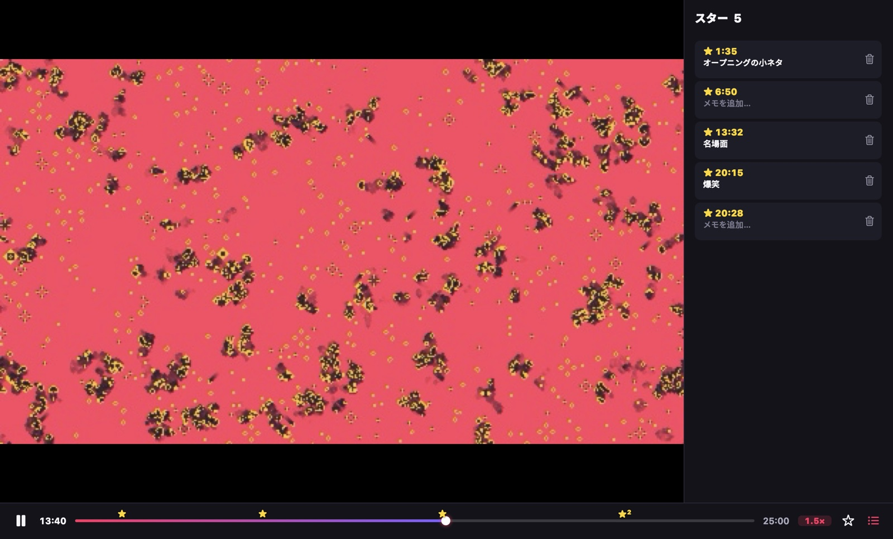
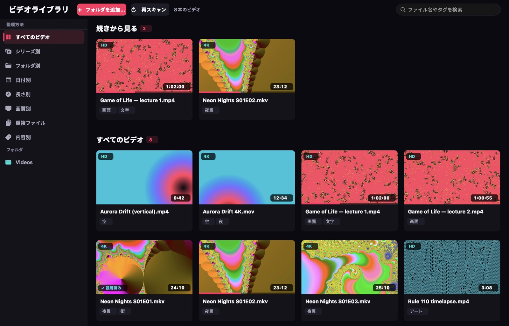
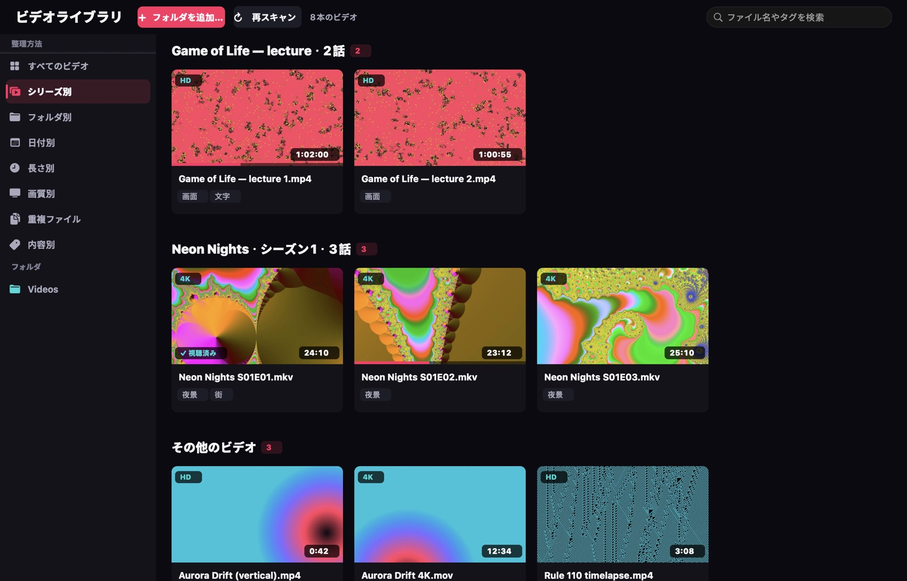

<p align="center"></p>

<h1 align="center">VideoTool</h1>

<p align="center"><b>あなたのペースについてくる Mac のビデオプレーヤー。</b><br>
長押しで速く、名場面にはスターを。AI字幕は無料で、あなたの Mac の中で作られます。</p>

<p align="center"><a href="README.md">English</a> · <a href="README.zh-CN.md">简体中文</a> · <b>日本語</b></p>

<p align="center"></p>

---

## VideoTool を作った理由

講義、ドラマ、アニメ、画面収録、ダウンロードした動画。多くの人が 1.5 倍や 2 倍で見て、退屈なところは飛ばしています。早く見終わりたい、でも大事な場面は逃したくない。VideoTool はそんな見方のために作りました。

- **🖱 長押しで速く、ドラッグで微調整。** 画面を長押しするとすぐ 2 倍速になります（いつも倍速で見ているなら、その速度よりさらに一段速く）。右へドラッグすると最大 6 倍、左へドラッグすると遅くなり、指を離せば元の速度に戻ります。このような操作ができるデスクトップのプレーヤーはほかにありません。
- **★ シークバーにスター。** いい場面で **B** を押すと、サムネイル付きのスターがシークバーに付きます。メモも残せます。クリックすれば 2 秒前から再生されるので、前後の流れもわかります。
- **🌐 AI字幕と翻訳が無料。** 英語、日本語、中国語、韓国語などのビデオに、数秒で字幕を作成します。訳文は原文の上に表示されます。すべて **Mac の中だけで** 処理するので、アップロードも料金もありません。
- **📚 自分で整理されるライブラリ。** ビデオを開くと、そのフォルダをライブラリに追加するか確認します。エピソードはシリーズごとに話数順に並び、「続きから見る」がいつも手元にあります。重複ファイルを見つけ、映っている内容にタグも付けます。ファイルを移動したり名前を変えたりすることはありません。
- **🎞 どんな形式でも再生。** mpv と FFmpeg を採用しているので、MKV、HEVC 10-bit、HDR10、AV1、VP9、WMV、FLV、古い AVI、複数の音声トラックや字幕トラックも扱えます。ハードウェアデコードにより、4K HDR でも CPU 1 コアの約 5 分の 1 しか使いません。
- **🔒 プライバシー重視。** アカウント不要で、トラッキングも分析もしません。ライブラリ、スター、字幕は `~/Library/Application Support/VideoTool` に保存されます。

## 画面で見る

| | |
|---|---|
|  |  |
| **AI字幕**（再生 › AI字幕…、⌘T）。話されている言語と翻訳先を選ぶだけで、数秒でできあがります。同じビデオを次に開くと自動で読み込まれます。 | **スター** にはメモとサムネイルが付きます。⌥← / ⌥→ でスター間を移動、⇧⌘B で一覧を開けます。 |
|  |  |
| **続きから見る** と、すべてのカバーに視聴位置のバー。見終わったビデオにはチェックが付きます。 | **シリーズ別** は S01E02、1x02、EP03、第2集、「タイトル - 07」などを認識します。間違っていたら、右クリック › シリーズ情報を編集。直した内容は、ファイル名を変えたり移動したりしても覚えています。 |

## 速度は思いのまま

| したいこと | 操作 |
|---|---|
| 一時的に速く | 画面を長押し（2 倍、またはいつもの速度 + 0.5 倍） |
| 長押し中にさらに速く / 遅く | 右へドラッグ（最大 6 倍）/ 左へドラッグ（最小 0.5 倍） |
| 速度を固定 | シークバー横の速度表示をクリック：0.75× – 3× |
| 細かく調整 | `[` / `]`（±0.1×）、`⌫` で 1.0× に戻す |

選んだ速度は記憶されます。講義をいつも 1.5 倍で見ているなら、次に開いたときも 1.5 倍です。6 倍まで上げても、声ははっきり聞こえ、ミュートされることはありません。

## キーボード

| キー | 動作 | キー | 動作 |
|---|---|---|---|
| スペース | 再生 / 一時停止 | B | スターを付ける（すぐもう一度押すと取り消し） |
| ← / → | 5 秒戻る / 進む（⇧：30 秒） | ⌥← / ⌥→ | 前 / 次のスター |
| ↑ / ↓ | 音量 | ⇧⌘B | スター一覧 |
| ⌘T | AI字幕 | S / A | 字幕 / 音声トラックを切り替え |
| ⌘L | ライブラリ | F | フルスクリーン |
| M | ミュート | ⌘O | ファイルを開く |

## 動作環境

- macOS 14 Sonoma 以降。Apple シリコンで動作を確認しています。
- AI字幕には **macOS 26** 以降が必要です。言語ごとの音声モデルと翻訳データは、システムが一度だけ無料でダウンロードします。

## インストール

署名済みのダウンロード版を準備中です。今はソースからビルドしてください（Xcode と [XcodeGen](https://github.com/yonaskolb/XcodeGen) が必要です）。

```sh
brew install xcodegen
git clone https://github.com/johnsonlee2801-source/VideoTool.git
cd VideoTool
scripts/regen.sh          # Xcode プロジェクトを生成
scripts/install.sh        # Release ビルドを /Applications にインストール
```

すべてのビデオを VideoTool で開くには、**ファイル › デフォルトのビデオプレーヤーに設定…** を選んでください。macOS が形式ごとに確認を求めます。

## 表示言語

インターフェイスは **English、简体中文、日本語** に対応し、Mac の言語設定に合わせて切り替わります。

## 品質

VideoTool はテストファーストで開発しています。約 400 の自動テストがあり、本物の再生エンジンや、Mac 上での本物の音声認識もテストしています。同梱したビデオ形式も一つずつ確認しています。プッシュのたびに個人情報が含まれていないかを自動で確認し、行カバレッジは 90% を超えています。詳しくは [CONTRIBUTING.md](CONTRIBUTING.md) をご覧ください。

## ロードマップ

- Apple TV や AirPlay 対応テレビへのキャスト（AirPlay スピーカーへの音声出力はすでに使えます：再生 › サウンド出力）
- 2 つのスターの間をクリップ、GIF、静止画として書き出し
- 画質の向上（フレーム補間、アニメのアップスケール）
- 複数の Mac でライブラリとスターを同期

ご意見や不具合の報告をお待ちしています。アプリの **ヘルプ › フィードバックを送信…** から、必要な情報が入力済みの Issue を開けます。

## 使用している技術

[mpv](https://mpv.io) と [FFmpeg](https://ffmpeg.org)（[MPVKit](https://github.com/mpvkit/MPVKit) 経由の LGPL ビルド）、Apple の Vision、Speech、Translation。ライセンスを含む一覧は [THIRD_PARTY_NOTICES.md](App/Resources/THIRD_PARTY_NOTICES.md) と、アプリの「VideoTool について」にあります。すべて LGPL または寛容なライセンスで、GPL のみのコンポーネントは含みません。

## ライセンス

VideoTool 自体のライセンスは、最初の公開リリースまでに発表します。
