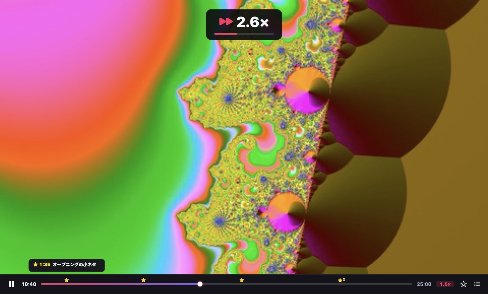
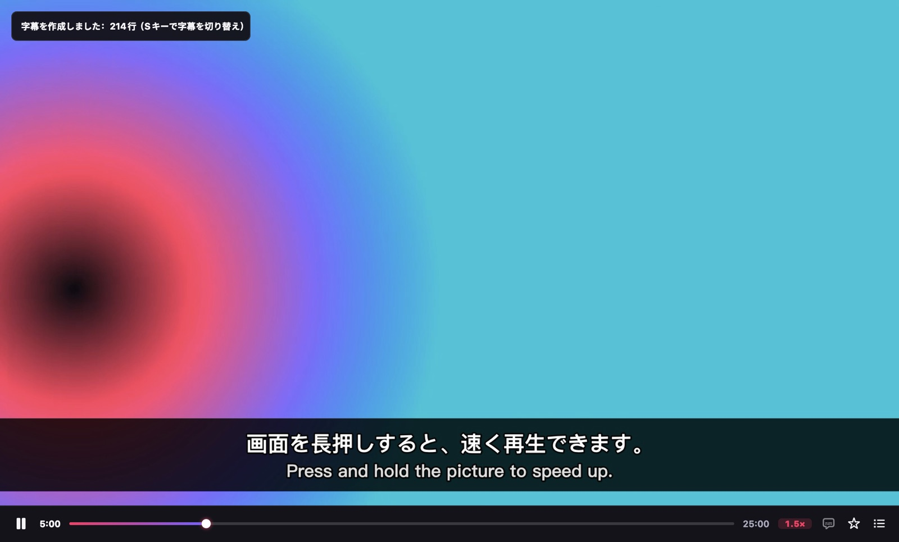
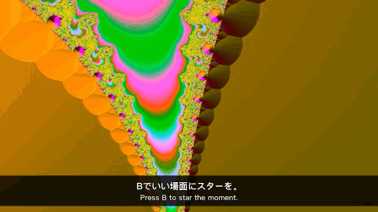

<h1 align="center">VideoTool</h1>

<b>速く見て、どの言語もわかって、いい場面を残す。</b> 
無料でオープンソースの Mac 用ビデオプレーヤー。

<a href="README.md">English</a> · <a href="README.zh-CN.md">简体中文</a> · <b>日本語</b>

---

VideoTool がするのは 3 つのことだけ。どれも、ほかのプレーヤーにはないやり方です。

## 1. 長押しで速く

画面を長押しすると、すぐ 2 倍速になります。**押したままドラッグ**すれば、右へ最大 6 倍、左へ 0.5 倍まで遅くなります。指を離せば元の速度に戻ります。退屈なところは速く、いい場面は逃さずに。

| したいこと | 操作 |
|---|---|
| 一時的に速く | 画面を長押し（2 倍、またはいつもの速度 + 0.5 倍） |
| 長押し中にさらに速く / 遅く | 右へドラッグ（最大 6 倍）/ 左へドラッグ（最小 0.5 倍） |
| 速度を固定 | シークバー横の速度表示をクリック：0.75× – 3× |
| 細かく調整 | `[` / `]`（±0.1×）、`⌫` で 1.0× に戻す |

6 倍でも声ははっきり聞こえます。いつもの速度は記憶されるので、講義をいつも 1.5 倍で見ているなら、次に開いたときも 1.5 倍です。

## 2. AI字幕を Mac の中で作成

英語、日本語、韓国語、中国語などのビデオに字幕がない？ **⌘T** を押すだけです。いま見ている位置から始まり、数秒で表示されます。訳文は原文の上に、細い半透明の帯の上に表示され、続きは見ているあいだに追加されます。

- **無料で、アップロードなし。** Apple の音声認識と翻訳を使い、すべて Mac の中で処理します。アカウントも不要です。
- 次に同じビデオを開くと、字幕はもう用意されています。`.srt` ファイルとして保存することもできます。
- 字幕がずれている？ **Z** / **X** で 0.1 秒早く / 遅くできます。

macOS 26 以降が必要です。言語ごとのデータは、システムが一度だけ無料でダウンロードします。

## 3. クリップや GIF を字幕ごと書き出し

いい場面で **B** を押すとシークバーにスターが付きます。終わりの場所でもう一度押して、**⌘E** で 2 つのスターの間を書き出します。

- **MP4**：VideoTool で再生できる形式（MKV、AV1、HEVC など）ならどれでも。QuickTime や写真で開けて、チャットアプリでそのまま送れます。
- **GIF**：そのまま SNS に投稿できます。
- **AI字幕を入れる** にチェックすると、画面の字幕が映像に焼き込まれます。上の GIF もこうして書き出しました。

## ほかのプレーヤーとの比較

| | VideoTool | IINA | VLC | Infuse |
|---|---|---|---|---|
| 画面の長押しで速く | 2 倍、ドラッグで 0.5〜6 倍 | — | — | 2 倍 |
| Mac 上で字幕を作成して翻訳 | ✓ | ダウンロードのみ | VLC 4 で予告 | ダウンロードのみ |
| 字幕付きでクリップ・GIF を書き出し | ✓ | プラグイン（ffmpeg が必要） | 変換/保存で可能 | — |
| 価格 | 無料、オープンソース | 無料、オープンソース | 無料、オープンソース | 無料、Pro はサブスクリプション |

2026 年 10 月時点の各アプリの公開情報にもとづきます。誤りがあれば Issue でお知らせください。

## インストール

1. [Releases](https://github.com/johnsonlee2801-source/VideoTool/releases/latest) から **VideoTool-x.y.z.dmg** をダウンロードし（Apple シリコンと Intel に対応、macOS 14 以降）、開いて VideoTool を「アプリケーション」にドラッグします。
2. 初めて開くとき、macOS は開発元を確認できないと表示します。VideoTool はまだ Apple の公証を受けていないためです。**完了** をクリックし、**システム設定 › プライバシーとセキュリティ** を開いて下へスクロールし、VideoTool の横の **このまま開く** をクリックして確認します。これは最初の一度だけです。

すべてのビデオを VideoTool で開くには、**ファイル › デフォルトのビデオプレーヤーに設定…** を選んでください。

ソースからビルドする方法は [CONTRIBUTING.md](CONTRIBUTING.md) をご覧ください。

## キーボード

| キー | 動作 | キー | 動作 |
|---|---|---|---|
| 画面を長押し | 速く（ドラッグで調整） | スペース | 再生 / 一時停止 |
| ⌘T | AI字幕 | Z / X | 字幕を 0.1 秒早く / 遅く |
| B | スターを付ける | ⌥← / ⌥→ | 前 / 次のスター |
| ⌘E | クリップや GIF を書き出す | ← / → | 5 秒戻る / 進む |

表示言語は English、简体中文、日本語 で、Mac の言語設定に合わせて切り替わります。ご意見や不具合の報告をお待ちしています。アプリの **ヘルプ › フィードバックを送信…** から、必要な情報が入力済みの Issue を開けます。

## 使用している技術

[mpv](https://mpv.io) と [FFmpeg](https://ffmpeg.org)（[MPVKit](https://github.com/mpvkit/MPVKit) 経由の LGPL ビルド）、Apple の Speech と Translation。ライセンスを含む一覧は [THIRD_PARTY_NOTICES.md](App/Resources/THIRD_PARTY_NOTICES.md) にあります。VideoTool は [Mozilla Public License 2.0](LICENSE) のオープンソースです。
