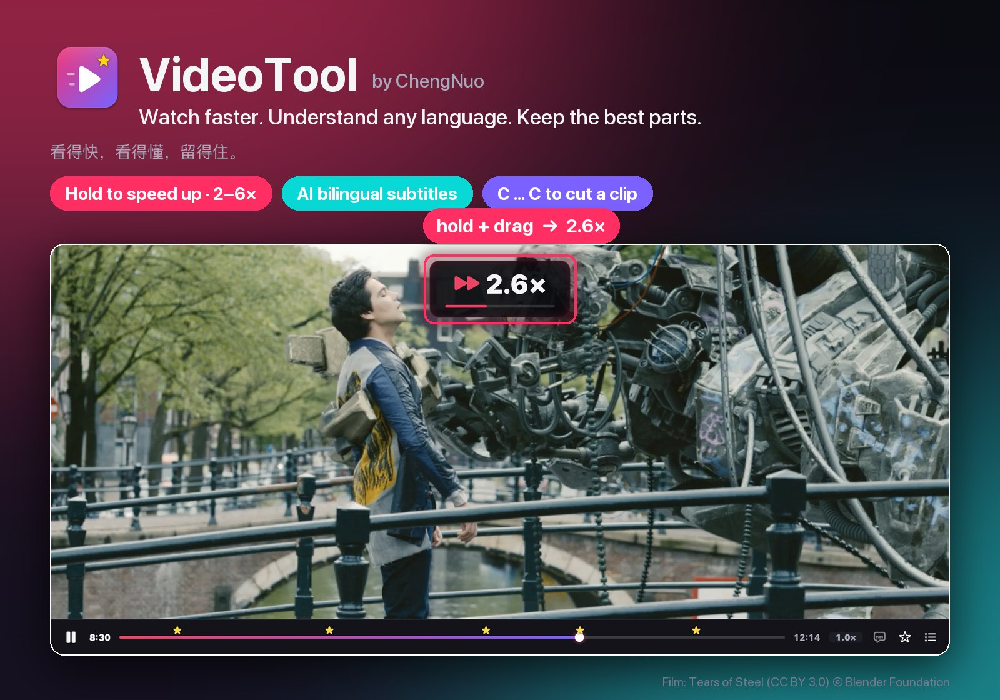
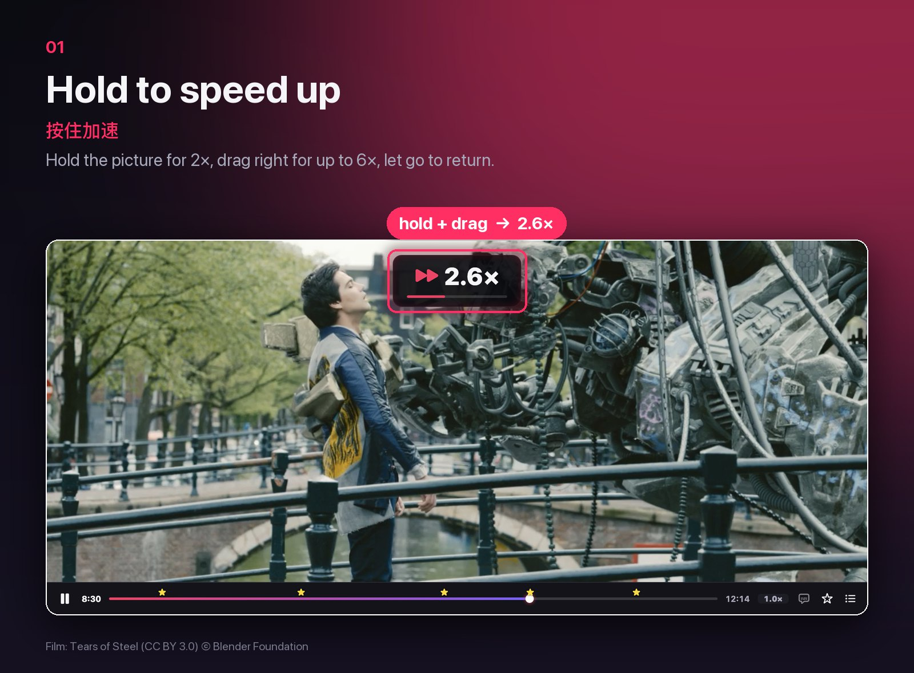
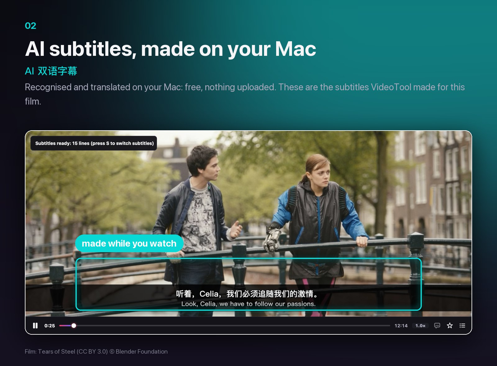
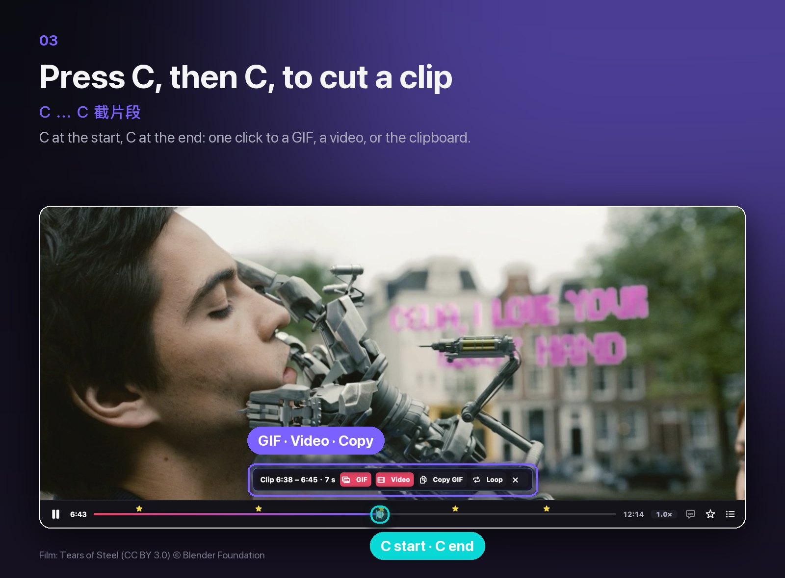

<b>English + 中文</b> · <a href="README.zh-CN.md">简体中文（完整版）</a> · <a href="README.ja.md">日本語</a>

<b>The Mac video player that keeps up with you. Free and open source.</b> 
<b>跟得上你节奏的 Mac 视频播放器。免费、开源。</b>

Made by <b>ChengNuo</b> · 由 <b>ChengNuo</b> 制作 — <a href="https://github.com/johnsonlee2801-source">GitHub</a> · <a href="https://blog.flowhunt.net/">blog.flowhunt.net</a>

<a href="https://github.com/johnsonlee2801-source/VideoTool/releases/latest"><b>⬇︎ Download for Mac · 下载 Mac 版</b></a>

---

VideoTool does three things other players don't do this way. 
VideoTool 只做好三件事，这三件事别的播放器都没这样做。

## 1. Hold to speed up · 按住加速

Press and hold the picture: 2×. **Keep holding and drag** right for up to 6×, left down to 0.5×. Let go and you're back. Skim the slow parts, miss nothing.

按住画面立刻 2 倍速；**按住不放再拖动**，往右最快 6 倍、往左慢到 0.5 倍；一松手就恢复。无聊的部分快快划过，精彩的地方一个不漏。

| Want · 想要 | Do · 怎么做 |
|---|---|
| A burst of speed · 临时快一下 | Hold the picture · 按住画面 |
| Faster / slower while holding · 按住时再快 / 再慢 | Drag right (6×) / left (0.5×) · 往右拖 / 往左拖 |
| A fixed speed · 固定倍速 | Click the speed label · 点进度条旁的速度标签 |
| Fine steps · 微调 | `[` / `]` ±0.1×, `⌫` 1.0× |

Voices stay clear up to 6×, and your usual speed is remembered. 
一直到 6 倍人声都清楚；常用的倍速会被记住。

## 2. AI subtitles, made on your Mac · AI 双语字幕，本机生成

No subtitles? Press **⌘T**. They start from where you are, appear within seconds, and fill in while you watch, with a translation above the original line. **Free and private**: Apple's speech recognition and translation, on your Mac. Nothing uploaded, no account. The lines above are what VideoTool actually made for this film.

没有字幕？按 **⌘T**。从你正在看的位置开始，几秒就出字，边看边补齐，译文在原文上方。**免费、不上传**：用 Apple 的语音识别和翻译，全在你的 Mac 上完成，不用注册。上图就是 VideoTool 为这部电影实际生成的字幕。

- Reopen the video and they're there; save as `.srt` · 下次打开自动加载，也能存成 `.srt`
- **Z** / **X**: 0.1 s earlier / later · 字幕提前 / 延后 0.1 秒

Needs macOS 26 or later · 需要 macOS 26 或更新版本。

## 3. Press C, then C, to cut a clip · C … C 截片段

**C** where the moment starts, **C** where it ends. A bar appears: **GIF**, **Video** (MP4 from any format: MKV, AV1, HEVC…), **Copy** straight to the clipboard, **Loop** to check the cut. One click, no dialog; files go to *Movies › VideoTool*. The subtitles on screen come along:

开头按 **C**，结尾再按 **C**，浮出工具条：**GIF**、**视频**（任何能放的格式都能导出 MP4）、**拷贝**（直接粘贴到微信）、**循环预览**。点一下就好，不弹对话框，文件存到「影片 › VideoTool」。屏幕上的字幕会一起带走：

**⌘C** copies the picture on screen, subtitles included · **⌘C** 拷贝当前画面（带字幕）。 
**B** stars stay bookmarks to jump back to · **B** 星标照旧，用来跳回去看。

## Compared · 和别的播放器比

| | VideoTool | IINA | VLC | Infuse |
|---|---|---|---|---|
| Hold to speed up · 按住加速 | 2×, drag 0.5–6× | — | — | 2× |
| Subtitles made on your Mac, translated · 本机生成并翻译字幕 | ✓ | Download only · 只能下载 | Announced for VLC 4 · 已宣布 | Download only · 只能下载 |
| Clip / GIF with subtitles · 带字幕的片段、GIF | ✓ | Plugins (ffmpeg) · 插件 | Convert / Save · 转换/保存 | — |
| Price · 价格 | Free, open source · 免费开源 | Free, open source | Free, open source | Free + Pro subscription |

From each app's public documentation, October 2026 · 依据 2026 年 10 月公开资料。Spot an error? Open an issue · 有出入欢迎提 issue。

## Install · 安装

1. Download **VideoTool-x.y.z.dmg** from [Releases](https://github.com/johnsonlee2801-source/VideoTool/releases/latest) (Apple silicon and Intel, macOS 14+) and drag VideoTool to Applications. 
   在 [Releases](https://github.com/johnsonlee2801-source/VideoTool/releases/latest) 下载 **VideoTool-x.y.z.dmg**（Apple 芯片和 Intel 都能用，macOS 14 起），拖进「应用程序」。
2. The first time, macOS can't verify the developer (VideoTool isn't notarized yet): click **Done**, then **System Settings › Privacy & Security › Open Anyway**. Once only. 
   第一次打开时 macOS 会说无法验证开发者（还没有 Apple 公证）：点 **完成**，到 **系统设置 › 隐私与安全性**，点 **仍要打开**。只需一次。

Build it yourself · 自己编译: [CONTRIBUTING.md](CONTRIBUTING.md)

## Keyboard · 快捷键

| Key · 按键 | Action · 作用 | Key · 按键 | Action · 作用 |
|---|---|---|---|
| Hold the picture · 按住画面 | Speed up · 加速 | Space · 空格 | Play / pause · 播放 / 暂停 |
| ⌘T | AI subtitles · AI 字幕 | Z / X | Subtitles earlier / later · 字幕提前 / 延后 |
| C, then C · C 再 C | Cut a clip · 截片段 | ⌘C | Copy the picture · 拷贝画面 |
| B | Star · 打星标 | ⌥← / ⌥→ | Previous / next star · 上 / 下一个星标 |
| ⌘E | Export dialog · 导出对话框 | ← / → | ∓5 s · 后退 / 前进 5 秒 |

Interface in English, 简体中文 and 日本語: **VideoTool › Language · 语言**. Feedback · 反馈: **Help › Send Feedback… · 帮助 › 发送反馈…**

## Author · 作者

VideoTool is designed and built by **ChengNuo**: every feature, from the hold-to-speed gesture to the on-device subtitles, came out of watching how people really watch videos. Follow along, or say hello, on [GitHub](https://github.com/johnsonlee2801-source) and [blog.flowhunt.net](https://blog.flowhunt.net/).

VideoTool 由 **ChengNuo** 设计和开发。从「按住加速」到「本机 AI 字幕」，每个功能都来自对大家真实看视频习惯的观察。欢迎在 [GitHub](https://github.com/johnsonlee2801-source) 和 [blog.flowhunt.net](https://blog.flowhunt.net/) 关注或交流。

## Built with · 致谢

[mpv](https://mpv.io) and [FFmpeg](https://ffmpeg.org) (LGPL builds via [MPVKit](https://github.com/mpvkit/MPVKit)), Apple Speech and Translation · 完整清单见 [THIRD_PARTY_NOTICES.md](App/Resources/THIRD_PARTY_NOTICES.md). © 2026 ChengNuo. VideoTool: [Mozilla Public License 2.0](LICENSE).

Pictures · 画面: [Tears of Steel](https://mango.blender.org) (CC BY 3.0) © Blender Foundation. The subtitles in them were made by VideoTool · 图中字幕由 VideoTool 生成。
