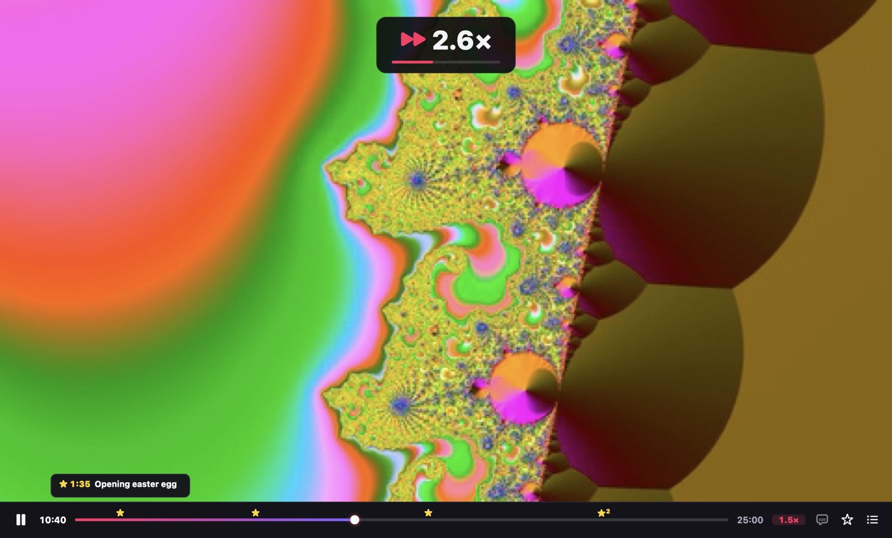
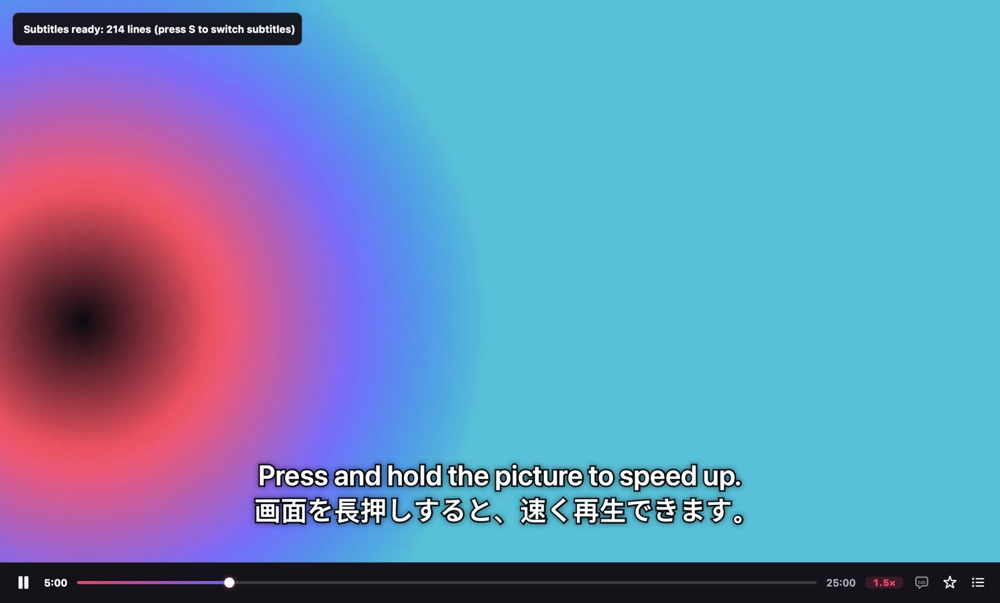
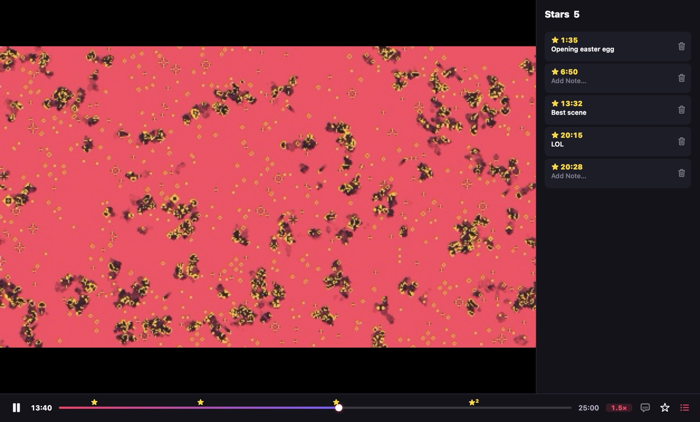
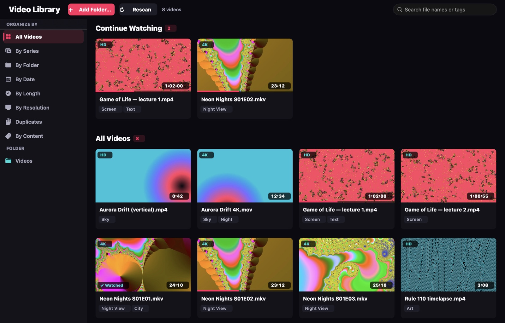
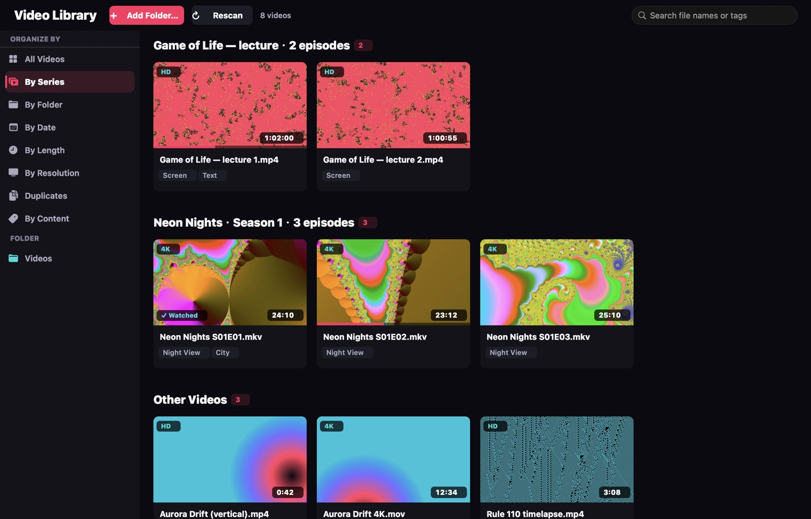

<p align="center"></p>

<h1 align="center">VideoTool</h1>

<p align="center"><b>The Mac video player that keeps up with you.</b><br>
Hold to speed up. Star the moments that matter. Free AI subtitles, made on your Mac.</p>

<p align="center"><b>English</b> · <a href="README.zh-CN.md">简体中文</a> · <a href="README.ja.md">日本語</a></p>

<p align="center"></p>

---

## Why VideoTool

Most of us watch at 1.5× or 2× and skip the boring parts. Lectures, series, anime, screen recordings, downloads: you want to get through them quickly without missing the good bits. VideoTool is built around that.

- **🖱 Hold to speed up, drag to fine-tune.** Press and hold the picture: it plays at 2× (or faster than your usual speed). Drag right for up to 6×, left to slow down. Let go and you're back. No other desktop player does this.
- **★ Stars on the timeline.** Press **B** at a great moment. A star appears on the progress bar with a thumbnail and an optional note. Click it to jump back (2 s early, so you catch the lead-in).
- **🌐 Free AI subtitles and translation.** Any video in English, Japanese, Chinese, Korean and more gets subtitles in seconds, with a translation shown above the original line. Everything runs **on your Mac**. Nothing is uploaded, and there's no fee.
- **📚 A library that organizes itself.** Open a video and VideoTool offers to add its folder. It groups episodes into series, keeps a *Continue Watching* row, finds duplicates and tags what's in the picture. Nothing is ever moved or renamed.
- **🎞 Plays everything.** It's built on mpv and FFmpeg: MKV, HEVC 10-bit, HDR10, AV1, VP9, WMV, FLV, old AVIs, multiple audio and subtitle tracks. Hardware decoding keeps a 4K HDR file at about a fifth of one CPU core.
- **🔒 Private by design.** No account, no tracking, no analytics. Your library, stars and subtitles stay in `~/Library/Application Support/VideoTool`.

## A closer look

| | |
|---|---|
|  |  |
| **AI subtitles** (Play › AI Subtitles…, ⌘T). Pick the spoken language and a translation, and they're ready in seconds. Reopen the video and they come back by themselves. | **Stars** with notes and thumbnails. Jump between them with ⌥← / ⌥→, or open the list with ⇧⌘B. |
|  |  |
| **Continue Watching** and progress bars on every cover. Finished videos get a tick. | **By Series** recognises S01E02, 1x02, EP03, 第2集, “Show - 07”… Got one wrong? Right-click › Edit Series Info. VideoTool remembers the fix, even after you rename or move the file. |

## Speed, your way

| Want | Do |
|---|---|
| A burst of speed | Hold the picture (2×, or 0.5× above your usual speed) |
| Faster / slower while holding | Drag right (up to 6×) / left (down to 0.5×) |
| A fixed speed | Click the speed label next to the timeline: 0.75× – 3× |
| Fine steps | `[` / `]` (±0.1×), `⌫` back to 1.0× |

VideoTool remembers your speed, so a lecture you watch at 1.5× opens at 1.5× next time. Speech stays clear and audible all the way up to 6×.

## Keyboard

| Key | Action | Key | Action |
|---|---|---|---|
| Space | Play / pause | B | Star this moment (press again to undo) |
| ← / → | Back / forward 5 s (⇧: 30 s) | ⌥← / ⌥→ | Previous / next star |
| ↑ / ↓ | Volume | ⇧⌘B | Star list |
| ⌘T | AI subtitles | S / A | Next subtitle / audio track |
| ⌘L | Library | F | Full screen |
| M | Mute | ⌘O | Open a file |

## Requirements

- macOS 14 Sonoma or later. Tested on Apple silicon.
- AI subtitles need **macOS 26** or later. The system downloads each speech model and translation language once, for free.

## Install

Signed downloads are on the way. For now, build it yourself (Xcode and [XcodeGen](https://github.com/yonaskolb/XcodeGen)):

```sh
brew install xcodegen
git clone https://github.com/johnsonlee2801-source/VideoTool.git
cd VideoTool
scripts/regen.sh          # generate the Xcode project
scripts/install.sh        # build Release and install to /Applications
```

To have VideoTool open all your videos, choose **File › Set as Default Video Player…**. macOS asks you to confirm each format.

## Languages

The interface is available in **English, 简体中文 and 日本語** and follows your Mac's language.

## Quality

VideoTool is developed test-first. About 400 automated tests run the real playback engine and real on-device speech recognition, plus every bundled video format. The code is checked for leaks of personal data before every push. Line coverage is above 90%. See [CONTRIBUTING.md](CONTRIBUTING.md).

## Roadmap

- Casting to Apple TV and AirPlay TVs (sound output to AirPlay speakers already works: Play › Audio Output)
- Export a clip, GIF or stills between two stars
- Picture enhancement (frame interpolation, anime upscaling)
- Library and stars synced across your Macs

Ideas and bug reports are welcome: **Help › Send Feedback…** in the app opens a pre-filled issue.

## Built with

[mpv](https://mpv.io) and [FFmpeg](https://ffmpeg.org) (LGPL builds via [MPVKit](https://github.com/mpvkit/MPVKit)), Apple Vision, Speech and Translation. The full list with licences is in [THIRD_PARTY_NOTICES.md](App/Resources/THIRD_PARTY_NOTICES.md) and in the app's About window. All are LGPL or permissive; nothing GPL-only is shipped.

## License

VideoTool is open source under the [Mozilla Public License 2.0](LICENSE) (MPL-2.0). You may use, study, change and share it; changes to VideoTool's own files stay open under the same licence, and VideoTool can be combined with other code. Third-party components keep their own licences (see above).
