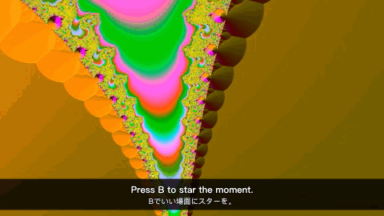

<h1 align="center">VideoTool</h1>

<b>Watch faster. Understand any language. Keep the best parts.</b> 
A free, open-source video player for the Mac.

<b>English</b> · <a href="README.zh-CN.md">简体中文</a> · <a href="README.ja.md">日本語</a>

---

VideoTool does three things that other players don't do this way.

## 1. Hold to speed up

Press and hold the picture and the video plays at 2×. **Keep holding and drag**: right for up to 6×, left to slow down to 0.5×. Let go and you're back to normal speed. It's for skimming the slow parts without missing anything.

| Want | Do |
|---|---|
| A burst of speed | Hold the picture (2×, or 0.5× above your usual speed) |
| Faster / slower while holding | Drag right (up to 6×) / left (down to 0.5×) |
| A fixed speed | Click the speed label next to the timeline: 0.75× – 3× |
| Fine steps | `[` / `]` (±0.1×), `⌫` back to 1.0× |

Voices stay clear all the way up to 6×. VideoTool remembers your usual speed, so a lecture you watch at 1.5× opens at 1.5× next time.

## 2. AI subtitles, made on your Mac

A video in English, Japanese, Korean, Chinese or another language, with no subtitles? Press **⌘T**. Subtitles start from where you are and appear within seconds, with a translation above the original line on a thin dark band. The rest fills in while you watch.

- **Free and private.** Everything runs on your Mac with Apple's speech recognition and translation. Nothing is uploaded and there is no account.
- Reopen the video and the subtitles are already there. Save them as an `.srt` file if you like.
- Out of sync? **Z** / **X** move subtitles 0.1 s earlier or later.

Needs macOS 26 or later. The system downloads each language once, for free.

## 3. Export a clip or GIF, subtitles included

Press **B** at a great moment to put a star on the timeline, and again where it ends. **⌘E** exports what's between the two stars:

- **MP4**: from any format VideoTool plays (MKV, AV1, HEVC…). It opens in QuickTime and Photos, and you can send it in any chat app.
- **GIF**: ready to post.
- Tick **Include AI subtitles** and the subtitles on screen are burned into the picture. The GIF above was made that way.

## Compared with other players

| | VideoTool | IINA | VLC | Infuse |
|---|---|---|---|---|
| Hold the picture to speed up | 2×, drag for 0.5×–6× | — | — | 2× |
| Subtitles generated on your Mac, with translation | ✓ | Download only | Announced for VLC 4 | Download only |
| Export a clip or GIF with subtitles | ✓ | Plugins (need ffmpeg) | Via Convert / Save | — |
| Price | Free, open source | Free, open source | Free, open source | Free, Pro subscription |

Based on each app's public documentation in October 2026. Spot something wrong? Please open an issue.

## Install

1. Download **VideoTool-x.y.z.dmg** from [Releases](https://github.com/johnsonlee2801-source/VideoTool/releases/latest) (Apple silicon and Intel, macOS 14 or later), open it and drag VideoTool to Applications.
2. The first time, macOS says it can't verify the developer: VideoTool isn't notarized by Apple yet. Click **Done**, open **System Settings › Privacy & Security**, scroll down and click **Open Anyway** next to VideoTool, then confirm. You only do this once.

To have VideoTool open all your videos, choose **File › Set as Default Video Player…**.

Or build it yourself: see [CONTRIBUTING.md](CONTRIBUTING.md).

## Keyboard

| Key | Action | Key | Action |
|---|---|---|---|
| Hold the picture | Speed up (drag to adjust) | Space | Play / pause |
| ⌘T | AI subtitles | Z / X | Subtitles 0.1 s earlier / later |
| B | Star this moment | ⌥← / ⌥→ | Previous / next star |
| ⌘E | Export clip or GIF | ← / → | Back / forward 5 s |

The interface is in English, 简体中文 and 日本語. Ideas and bug reports are welcome: **Help › Send Feedback…** in the app opens a pre-filled issue.

## Built with

[mpv](https://mpv.io) and [FFmpeg](https://ffmpeg.org) (LGPL builds via [MPVKit](https://github.com/mpvkit/MPVKit)), Apple Speech and Translation. The full list with licences is in [THIRD_PARTY_NOTICES.md](App/Resources/THIRD_PARTY_NOTICES.md). VideoTool is open source under the [Mozilla Public License 2.0](LICENSE).
