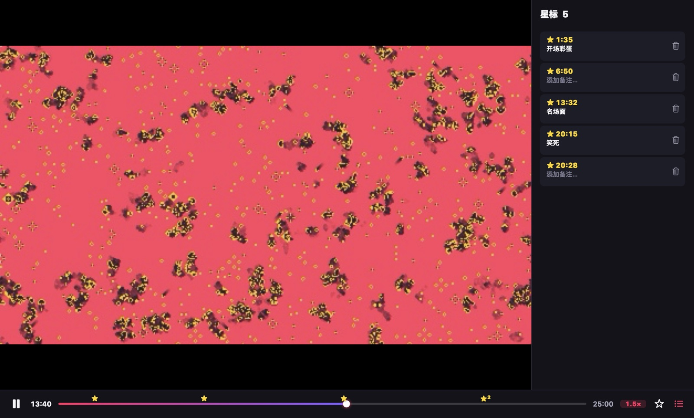
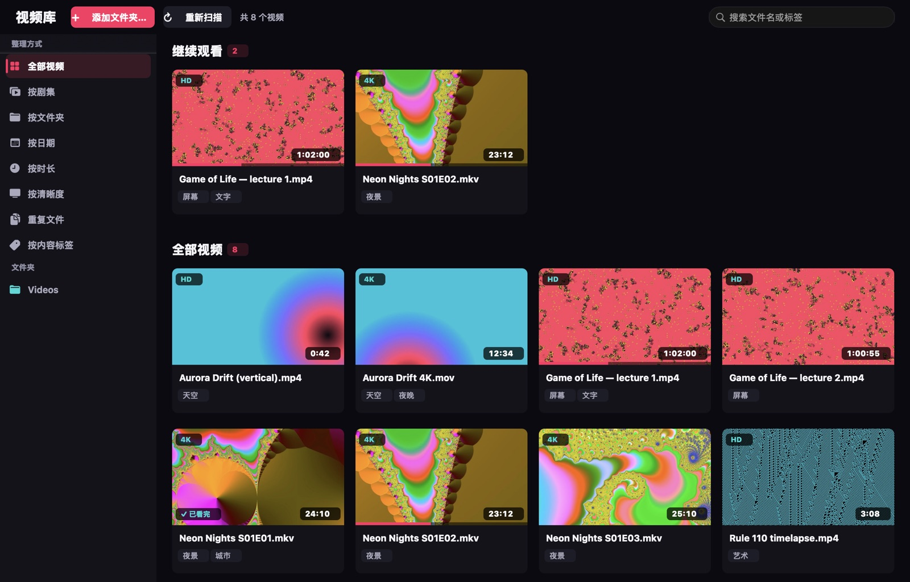
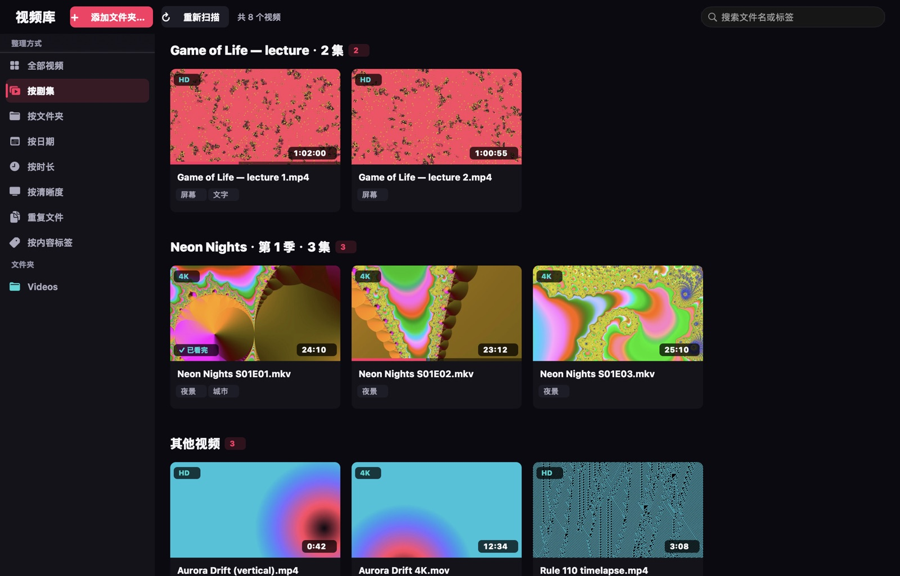

<p align="center"></p>

<h1 align="center">VideoTool</h1>

<p align="center"><b>跟得上你节奏的 Mac 视频播放器。</b><br>
按住就加速，精彩时刻打颗星，AI 字幕免费、在你的 Mac 上生成。</p>

<p align="center"><a href="README.md">English</a> · <b>简体中文</b> · <a href="README.ja.md">日本語</a></p>

<p align="center"></p>

---

## 为什么是 VideoTool

现在大多数人看视频都开 1.5 倍、2 倍，遇到无聊的部分就想跳过：网课、追剧、动漫、录屏、下载的视频都是这样。大家想快点看完，又不想错过精彩的地方。VideoTool 就是围绕这个习惯设计的。

- **🖱 按住加速，拖动微调。** 在画面上按住鼠标，立刻 2 倍速（如果你平时开着倍速，就在你的速度上再快一档）。按住不放往右拖最高 6 倍，往左拖放慢；一松手就恢复。
- **★ 进度条上打星标。** 看到精彩的地方按 **B**，进度条上就多一颗星，带缩略图，还能加备注。点一下星就跳回去，会提前 2 秒，让你看到前因。两颗星之间的部分可以导出成 MP4、GIF 或一组截图。
- **🌐 AI 字幕和翻译，免费。** 英语、日语、中文、韩语等视频，边看边生成：从你正在看的位置开始，几秒就出字，译文在原文上方，垫一条细细的半透明黑条。全部**在你的 Mac 上完成**：不上传，不收费。也可以存成 .srt 文件。
- **📚 会自己整理的视频库。** 打开视频时，VideoTool 会问要不要把这个文件夹加入视频库。它会把剧集按集数排好，提供「继续观看」，找出重复文件，还能按画面内容打标签。整个过程不会移动或重命名任何文件。
- **🎞 什么格式都能放。** 基于 mpv 和 FFmpeg：MKV、HEVC 10-bit、HDR10、AV1、VP9、WMV、FLV、老的 AVI、多音轨多字幕都可以。用硬件解码，放 4K HDR 只占约五分之一个 CPU 核心。
- **⏭ 少等一点。** 片头在哪结束、片尾从哪开始，标一次就行：这部剧每一集都会自动跳过，片尾直接进下一集。鼠标停在进度条上能预览画面。夜间模式让人声更清楚、爆炸的轰鸣小一些。
- **🧠 每个视频都记得。** 看到哪、选了哪条音轨和字幕、字幕调早调晚了多少，重新打开都还在。
- **🔒 隐私优先。** 不用注册，不跟踪，不收集数据。视频库、星标和字幕都存在 `~/Library/Application Support/VideoTool`。

## 和别的播放器有什么不同

Mac 上已经有很好的播放器。下面是 VideoTool 多出来的东西，也写清楚了别人更强的地方。

| | VideoTool | IINA | VLC | Infuse |
|---|---|---|---|---|
| 价格和源码 | 免费，开源（MPL-2.0） | 免费，开源 | 免费，开源 | 免费，Pro 需订阅 |
| 按住画面加速 | 2 倍，拖动 0.5–6 倍 | — | — | 2 倍 |
| 进度条星标（带缩略图和备注） | ✓ | — | 书签（无缩略图） | — |
| 在本机生成字幕并翻译 | ✓（macOS 26） | 只能下载 | VLC 4 已宣布 | 只能下载 |
| 导出片段、GIF、截图组 | ✓ | 截图 | 用「转换/保存」 | — |
| 按剧集整理本地文件夹的视频库 | ✓ | — | — | ✓（带网上海报） |
| 跳过片头片尾 | ✓（自己标一次） | — | — | ✓（来自在线数据库） |
| 播放 MKV、HEVC、AV1、HDR | ✓ | ✓ | ✓ | ✓ |

要在 Windows、Linux、手机上用，选 **VLC**；要从 NAS、Plex、Jellyfin 串流、在 Apple TV 上看，选 **Infuse**；要成熟的 mpv 播放器、插件和在线视频，选 **IINA**。VideoTool 适合快速看完自己的视频，又不错过精彩部分。

<sub>依据 2026 年 10 月各软件的公开资料。如有出入，欢迎提 issue 指正。</sub>

## 看看效果

| | |
|---|---|
|  |  |
| **AI 字幕**（播放 › AI 字幕…，⌘T）。选好视频语言和翻译语言，几秒就好。下次打开同一个视频，字幕会自动加载。 | **星标**带备注和缩略图。用 ⌥← / ⌥→ 在星标之间跳转，⇧⌘B 打开星标列表。 |
|  |  |
| **继续观看**，每个封面都显示看到哪里了，看完的会打勾。 | **按剧集**能认出 S01E02、1x02、EP03、第2集、「剧名 - 07」等命名。归错了？右键 › 修改剧集信息。改过的会记住，文件改名或移动后也有效。 |

## 倍速，随你

| 想要 | 怎么做 |
|---|---|
| 临时快一下 | 按住画面（2 倍，或比你平时的速度快 0.5 倍） |
| 按住时再快 / 再慢 | 往右拖（最高 6 倍）/ 往左拖（最低 0.5 倍） |
| 固定倍速 | 点进度条旁的速度标签：0.75× – 3× |
| 微调 | `[` / `]`（每次 ±0.1×），`⌫` 恢复 1.0× |

VideoTool 会记住你选的速度：网课一直开 1.5 倍，下次打开就是 1.5 倍。一直加到 6 倍，人声也清楚、不会被静音。

## 快捷键

| 按键 | 作用 | 按键 | 作用 |
|---|---|---|---|
| 空格 | 播放 / 暂停 | B | 打星标（马上再按一次撤销） |
| ← / → | 后退 / 前进 5 秒（⇧：30 秒） | ⌥← / ⌥→ | 上一个 / 下一个星标 |
| ↑ / ↓ | 音量 | ⇧⌘B | 星标列表 |
| ⌘T | AI 字幕 | S / A | 切换字幕 / 音轨 |
| ⌘L | 视频库 | F | 全屏 |
| M | 静音 | ⌘O | 打开文件 |
| Z / X | 字幕提前 / 延后 0.1 秒 | ⌘E | 导出片段 |

## 系统要求

- macOS 14 Sonoma 或更新版本，已在 Apple 芯片上测试。
- AI 字幕需要 **macOS 26** 或更新版本。每种语言的语音模型和翻译语言包由系统免费下载，只下载一次。

## 安装

1. 在 [Releases](https://github.com/johnsonlee2801-source/VideoTool/releases/latest) 下载 **VideoTool-x.y.z.dmg**（Apple 芯片和 Intel 都能用），打开后把 VideoTool 拖进「应用程序」。
2. 第一次打开时，macOS 会说无法验证开发者：VideoTool 还没有经过 Apple 公证。点 **完成**，打开 **系统设置 › 隐私与安全性**，往下拉，在 VideoTool 旁边点 **仍要打开**，再确认一次。只需要做这一次。

也可以自己编译（需要 Xcode 和 [XcodeGen](https://github.com/yonaskolb/XcodeGen)）：

```sh
brew install xcodegen
git clone https://github.com/johnsonlee2801-source/VideoTool.git
cd VideoTool
scripts/regen.sh          # 生成 Xcode 工程
scripts/install.sh        # 编译 Release 版并装进「应用程序」
```

想让所有视频都用 VideoTool 打开，就选 **文件 › 设为默认视频播放器…**。macOS 会对每种格式各弹一次确认。

## 界面语言

界面有 **English、简体中文、日本語** 三种，会跟随 Mac 的系统语言。

## 质量

VideoTool 先写测试再写代码，有约 450 项自动测试：真实播放引擎和真实本机语音识别都在测试范围内，每种内置视频格式也逐一测过。每次推送前会自动检查有没有个人信息泄露，代码行覆盖率在 90% 以上。详见 [CONTRIBUTING.md](CONTRIBUTING.md)。

## 路线图

- 投屏到 Apple TV 和支持 AirPlay 的电视（声音输出到 AirPlay 音箱已经可以用：播放 › 声音输出）
- 画质增强（补帧、动漫超分）
- 多台 Mac 同步视频库和星标

欢迎提建议、报问题：在 App 里选 **帮助 › 发送反馈…**，会打开一个已经填好基本信息的问题页面。

## 致谢

[mpv](https://mpv.io) 和 [FFmpeg](https://ffmpeg.org)（经 [MPVKit](https://github.com/mpvkit/MPVKit) 使用的 LGPL 版本），以及 Apple 的 Vision、Speech、Translation。完整清单和许可证见 [THIRD_PARTY_NOTICES.md](App/Resources/THIRD_PARTY_NOTICES.md)，App 的「关于」窗口里也有。全部为 LGPL 或宽松许可证，没有只限 GPL 的组件。

## 许可证

VideoTool 以 [Mozilla Public License 2.0](LICENSE)（MPL-2.0）开源。你可以使用、研究、修改和分享它。修改 VideoTool 自己的文件后，修改部分也要按同一许可证开放；VideoTool 也可以和其他代码组合使用。第三方组件仍按各自的许可证（见上文）。
