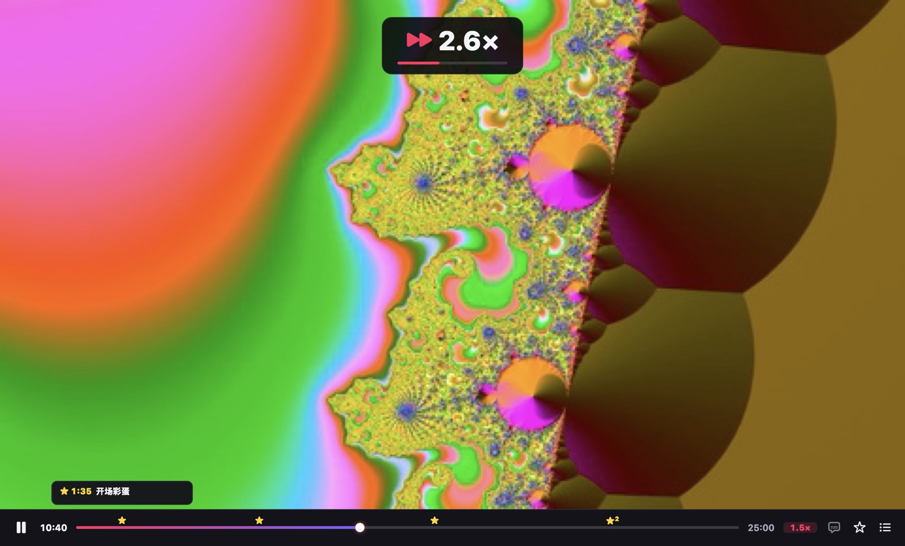
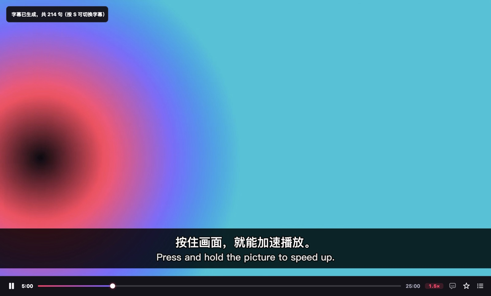

<h1 align="center">VideoTool</h1>

<b>看得快，看得懂，留得住。</b> 
免费开源的 Mac 视频播放器。

<a href="README.md">English</a> · <b>简体中文</b> · <a href="README.ja.md">日本語</a>

---

VideoTool 只做好三件事，这三件事别的播放器都没这样做。

## 1. 按住加速

在画面上按住鼠标，立刻 2 倍速。**按住不放再拖动**：往右最快 6 倍，往左放慢到 0.5 倍。一松手，恢复原来的速度。无聊的部分快快划过，精彩的地方一个不漏。

| 想要 | 怎么做 |
|---|---|
| 临时快一下 | 按住画面（2 倍，或比你平时的速度快 0.5 倍） |
| 按住时再快 / 再慢 | 往右拖（最高 6 倍）/ 往左拖（最低 0.5 倍） |
| 固定倍速 | 点进度条旁的速度标签：0.75× – 3× |
| 微调 | `[` / `]`（每次 ±0.1×），`⌫` 恢复 1.0× |

一直加到 6 倍，人声也清楚。VideoTool 会记住你平时的倍速：网课一直开 1.5 倍，下次打开就是 1.5 倍。

## 2. AI 字幕，在你的 Mac 上生成

英语、日语、韩语、中文等视频没有字幕？按 **⌘T**。从你正在看的位置开始，几秒就出字，译文在原文上方，垫一条细细的半透明黑条；后面的字幕边看边补上。

- **免费，不上传。** 用 Apple 的语音识别和翻译，全部在你的 Mac 上完成，不用注册账号。
- 下次打开同一个视频，字幕已经在了；也可以存成 `.srt` 文件。
- 字幕对不上？按 **Z** / **X** 提前或延后 0.1 秒。

需要 macOS 26 或更新版本。每种语言由系统免费下载一次。

## 3. 导出片段或 GIF，字幕一起带走

看到精彩的地方按 **B**，进度条上多一颗星；在结束的地方再按一次。按 **⌘E**，就能导出两颗星之间的部分：

- **MP4**：VideoTool 能放的格式（MKV、AV1、HEVC……）都能导出，QuickTime、照片都能打开，也能直接发到微信。
- **GIF**：直接发朋友圈、小红书。
- 勾上 **带上 AI 字幕**，屏幕上的字幕就烧进画面里。上面这张 GIF 就是这样导出的。

## 和别的播放器比

| | VideoTool | IINA | VLC | Infuse |
|---|---|---|---|---|
| 按住画面加速 | 2 倍，拖动 0.5–6 倍 | — | — | 2 倍 |
| 在本机生成字幕并翻译 | ✓ | 只能下载 | VLC 4 已宣布 | 只能下载 |
| 导出带字幕的片段、GIF | ✓ | 插件（需另装 ffmpeg） | 用「转换/保存」 | — |
| 价格 | 免费，开源 | 免费，开源 | 免费，开源 | 免费，Pro 需订阅 |

依据 2026 年 10 月各软件的公开资料。如有出入，欢迎提 issue 指正。

## 安装

1. 在 [Releases](https://github.com/johnsonlee2801-source/VideoTool/releases/latest) 下载 **VideoTool-x.y.z.dmg**（Apple 芯片和 Intel 都能用，需要 macOS 14 或更新版本），打开后把 VideoTool 拖进「应用程序」。
2. 第一次打开时，macOS 会说无法验证开发者：VideoTool 还没有经过 Apple 公证。点 **完成**，打开 **系统设置 › 隐私与安全性**，往下拉，在 VideoTool 旁边点 **仍要打开**，再确认一次。只需要做这一次。

想让所有视频都用 VideoTool 打开，就选 **文件 › 设为默认视频播放器…**。

也可以自己编译，见 [CONTRIBUTING.md](CONTRIBUTING.md)。

## 快捷键

| 按键 | 作用 | 按键 | 作用 |
|---|---|---|---|
| 按住画面 | 加速（拖动调速） | 空格 | 播放 / 暂停 |
| ⌘T | AI 字幕 | Z / X | 字幕提前 / 延后 0.1 秒 |
| B | 打星标 | ⌥← / ⌥→ | 上一个 / 下一个星标 |
| ⌘E | 导出片段或 GIF | ← / → | 后退 / 前进 5 秒 |

界面有 English、简体中文、日本語，跟随系统语言。欢迎提建议、报问题：在 App 里选 **帮助 › 发送反馈…**，会打开一个已填好基本信息的问题页面。

## 致谢

[mpv](https://mpv.io) 和 [FFmpeg](https://ffmpeg.org)（经 [MPVKit](https://github.com/mpvkit/MPVKit) 使用的 LGPL 版本），以及 Apple 的 Speech、Translation。完整清单和许可证见 [THIRD_PARTY_NOTICES.md](App/Resources/THIRD_PARTY_NOTICES.md)。VideoTool 以 [Mozilla Public License 2.0](LICENSE) 开源。
